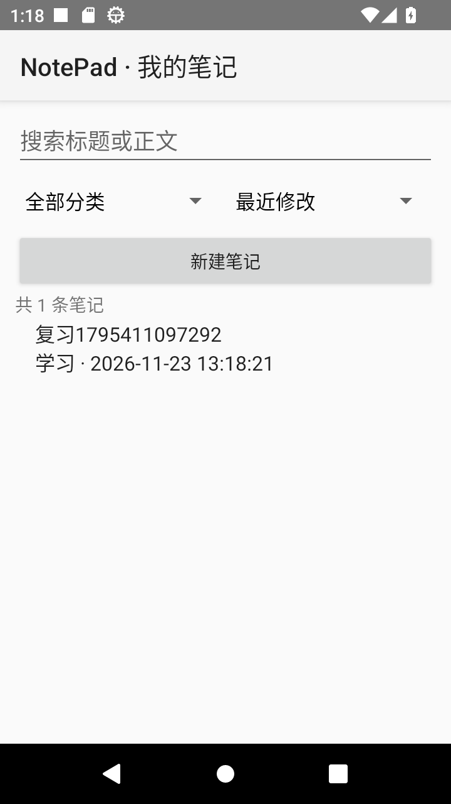
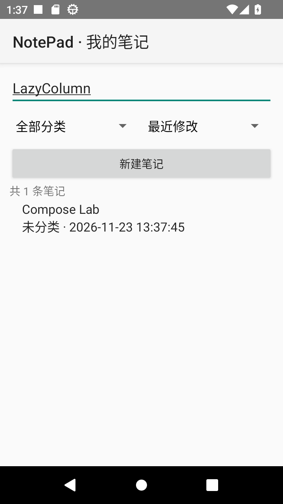
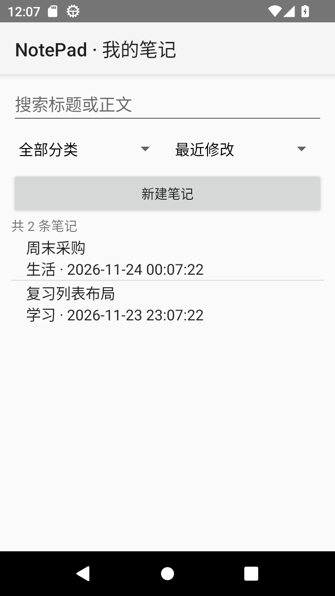
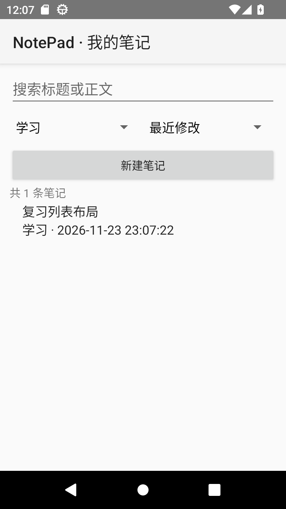

# 期中 · NotePad 记事本

基于[课程指定的 NotePad](https://github.com/fjnu-cse/NotePad/tree/9279eab943f50012dd299df3417259e3478c8364)。保留上游的 `NotePad.java` 数据契约和 `NotePadProvider.java` SQLite 数据提供器，保留原文件版权声明。将旧工程迁移至 Gradle 8.9，重写列表与编辑交互，使用不对其他应用开放的 provider。上游样例不是本次原创部分。

## 运行效果

| 笔记列表 | 正文搜索 |
| --- | --- |
|  |  |
| 列表中每条笔记显示分类和最后修改时间。 | 搜索正文中的 LazyColumn，命中标题不含该词的 Compose Lab。 |

### 扩展一：按分类筛选

两张图使用同一组笔记，搜索框均为空。把「全部分类」切换为「学习」后，计数从 2 条变为 1 条：「复习列表布局」保留，属于「生活」的「周末采购」不再显示。切回「全部分类」即可再次看到它。

| 全部分类 · 2 条 | 只看学习 · 1 条 |
| --- | --- |
|  |  |

### 扩展二：按修改时间排序

恢复「全部分类」，只切换排序方式。「周末采购」修改时间较晚，在「最近修改」中排第一；改成「最早修改」后，「复习列表布局」排第一。前后都是同样的 2 条笔记，只有顺序改变。

| 最近修改 · 新 → 旧 | 最早修改 · 旧 → 新 |
| --- | --- |
|  |  |

## 运行

已在 Android 13（API 33）模拟器构建、安装并运行设备验收测试。连接测试设备后可用 `.\gradlew.bat connectedDebugAndroidTest` 重跑；测试会在应用中操作，请使用测试设备。

在 Android Studio 中打开本仓库根目录，使用 JDK 17、Android SDK Platform 35 和 Build Tools 34.0.0。选择 API 26 或更高版本的设备，等待 Gradle 同步后运行 app。Windows 命令行也可在仓库根目录执行：

```powershell
.\gradlew.bat assembleDebug
.\gradlew.bat installDebug
```

第一条只构建，第二条需要已连接且获授权的设备或启动的模拟器。仓库只跟踪源码、资源与构建配置，不提交本机 SDK、缓存、密钥或 APK。

## 功能与使用

| 类型 | 功能 | 如何检查 |
|---|---|---|
| 基础 | 列表显示时间戳 | 新建并保存笔记，列表标题下一行显示最后修改日期与时间；稍后编辑保存，时间更新 |
| 基础 | 标题、正文查询 | 搜索框即时过滤，匹配任一字段即可；清空回到当前分类。英文忽略 ASCII 大小写 |
| 扩展一 | 笔记分类 | 创建或编辑时选择未分类、学习、生活或工作；在列表用分类下拉筛选 |
| 扩展二 | 笔记排序 | 切换最近修改、最早修改、标题升序；可与分类和搜索组合 |

点笔记进入编辑；长按可删除，删除前有确认；取消编辑不保存。标题不能为空。内容仅保存在应用私有数据库中，不需联网。未实现云同步；卸载或清除应用数据会移除笔记。

## 数据与实现

- `Main.java` 负责列表、编辑、搜索、筛选与排序；通过 ContentResolver 访问数据。
- `NotePadProvider.java` 管理 notes 表。保留上游 _id、title、note、created、modified；增加 category 列。v2 → v3 迁移只增加列，不清表，旧记录默认为“未分类”。
- 保存时写入修改时间（毫秒）；显示时转换至本机时区。搜索文本作为查询参数传入；排序只使用预定义表达式，不把输入文本拼进 SQL。
- 分类、正文、时间等随笔记持久化；退出应用重新打开仍可见。

## 建议验收样例

创建“Android 复习”（正文含 LazyColumn，分类学习）和“买牛奶”（生活）。搜索 LazyColumn，列表应只剩第一条；切到生活，应为空；清空搜索，应只剩买牛奶。恢复全部分类，切换时间正序与倒序，编辑较早的记录，检查它在“最近修改”中排第一。关闭重开核对笔记仍在。
